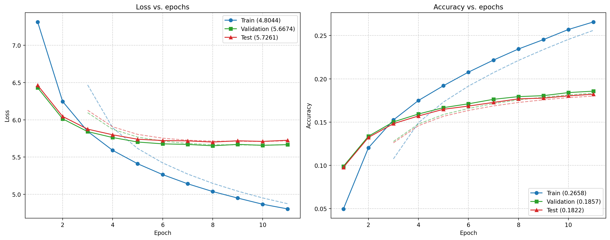

# Metrics

Measured 2026-10-08 on a Quadro RTX 5000 laptop GPU. "Before" is commit `7250964`, "after" is the current code. Raw numbers: `benchmarks/out/results.json`, `logs/training.log`, `logs/prompt_*_comparison.json`. Reproduce with `python benchmarks/bench.py --all`.

## Training on YouTube comments (`python main.py yt`)

| | before | after |
|---|---:|---:|
| tokenizer / vocab | mt5, 250 100 | SentencePiece on the corpus, 8 000 |
| parameters (share in vocab layers) | 99.8 M (96 %) | 6.4 M (48 %) |
| comments producing data | 5.4 % | 98.3 % |
| val chunks sharing a comment with train | 85 % | 0 % |
| epochs / wall time | 40 / 11 h 51 m | 12 (early stop) / 32 m |
| best val loss / accuracy | 7.96 / 0.145 (= majority-token share) | **5.65 / 0.179** |
| test loss / accuracy | 7.94 / 0.146 | **5.70 / 0.177** |
| majority-token baseline accuracy | 0.147 | 0.029 |

## Decoding (best checkpoint, GPU, 50-token limit, 4 prompts)

| method | seconds per prompt | note |
|--------|-------------------:|------|
| Greedy | 0.1 - 0.8 | deterministic, stops at EOS |
| Sampling (temp 0.7 / 1.2) | 0.2 - 1.1 | |
| Beam search (4 beams) | 0.8 - 2.4 | before the fix it returned the prompt unchanged |
| MTP speculation, greedy | 0.1 - 0.7 | identical output to greedy; 25 - 50 % of drafts accepted on long continuations |
| MTP speculation, temp 0.7 | 0.1 - 0.4 | 11 - 25 % of drafts accepted |

No KV cache, so speculation does not yet reduce wall time. Example sentences are in the README.

## Step throughput (synthetic batch 16 x 128)

| vocab | params | train step | tokens/s | peak VRAM |
|------:|-------:|-----------:|---------:|----------:|
| 8 000 (default) | 6.4 M | **178 ms** | 11 500 | 0.75 GB |
| 50 258 | 22.7 M | 402 ms | 5 100 | 2.8 GB |
| 250 100 (mt5, before) | 99.8 M | 1 425 ms | 1 440 | 12.5 GB |

## MoE load balancing (200 steps, skewed input, 4 experts / top-2)

| routing-bias rule | final load per expert | final bias |
|-------------------|-----------------------|------------|
| old (`bias += s*(load-ema)`, bias inside the gate weights) | .50 / .00 / .50 / .00 | 20.5 / 0 / 20.5 / 0 |
| none | .35 / .20 / .29 / .16 | 0 |
| current (DeepSeek-V3: `bias -= s*sign(load-mean)`, selection only) | .25 / .25 / .25 / .25 | +-0.1 |

Wall-clock numbers include stretches where the laptop GPU thermally throttled.
