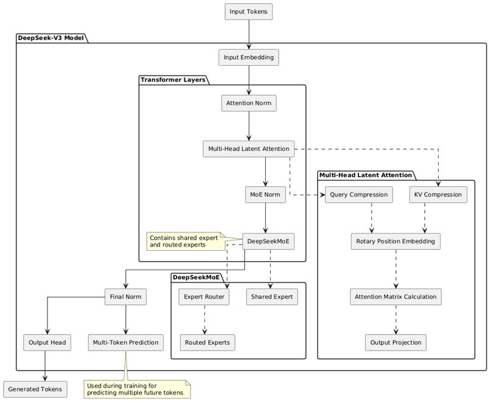

# deepseekv3-minimal
Creating the DeepSeek V3 model from scratch, as small and readable as possible.

* Multi-head Latent Attention (key/value and query compression) with RoPE
* Mixture of experts with a shared expert and DeepSeek-V3 auxiliary-loss-free load balancing
* Multi Token Prediction (MTP) head, also used as the draft model for speculative decoding
* Greedy, sampled, beam-search and MTP-speculative text generation
* Basic training loop with checkpoints, plots and early stopping
* Not everything follows the paper exactly; this is a personal learning effort



## Quick start
```
pip install -r requirements.txt       # torch CUDA note inside the file
python main.py yt                     # train on YouTube comments
python main.py wiki                   # train on Simple-English Wikipedia
python run_text_generation.py --model_path checkpoints/best_model.pt --prompt "this video is"
python -m pytest tests                # 41 unit tests, CPU, ~20 s
```
Settings live in `config/` (`base.yaml` picks the tokenizer: a small SentencePiece model trained on the corpus by
default, or `mt5`). Training writes `logs/training.log`, `checkpoints/` and `plots/`, and logs a few generated
sentences at the end.

## Results on YouTube comments
6.4M parameters, 8000-piece tokenizer, 12 epochs (early stopped) in 32 minutes on a laptop GPU.
Validation accuracy 0.179 and test accuracy 0.177 against a 0.029 majority-token baseline.


Greedy continuations from the best checkpoint (the corpus is lower-case, so prompts are too):

| prompt | generated |
|--------|-----------|
| this video is | this video is so amazing ive been watching your videos and you are very helpful thank you |
| i think the best part | i think the best part of this song |
| thanks for sharing | thanks for sharing this video ive been able to learn more than my portfolio in the future |
| can someone explain why | can someone explain why he never takes credit for himself when he achieves something he always respect us the audience and his team and he is polite in all of his videos |

Sampled (temperature 0.7):

| prompt | generated |
|--------|-----------|
| this video is | this video is so hard to see in the future of us and just put them into a day |
| i think the best part | i think the best part where you said in this video |
| thanks for sharing | thanks for sharing your videos and pleasantly for the greatness of content |
| can someone explain why | can someone explain why you always want to be a job |

More numbers in [METRICS.md](METRICS.md), the code review that led here in [REVIEW.md](REVIEW.md), tests and
environment in [TESTING.md](TESTING.md).

## Datasets
[YouTube Comments](https://www.kaggle.com/datasets/atifaliak/youtube-comments-dataset/data) (set `csv_path` in `config/train_yt.yaml`)

[Hugging Face Wikipedia](https://huggingface.co/datasets/legacy-datasets/wikipedia/tree/main/data/20220301.simple)
